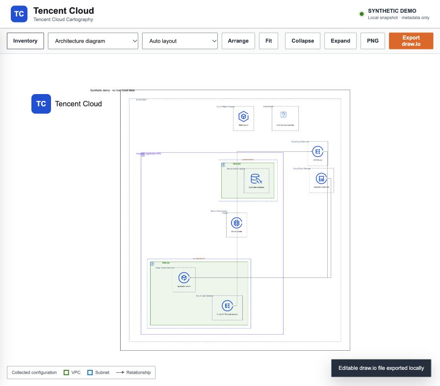

# Tencent Cloud Cartography

Local Tencent Cloud inventory, relationship exploration, and editable architecture diagrams.
A derivative of [raph-rcn/aws-cartography](https://github.com/raph-rcn/aws-cartography), retaining its Git history and adapting its Landscape interface to Tencent Cloud.

- **Frankfurt by default:** `eu-frankfurt` (Tencent's region code).
- **Read-only collection:** existing TCCLI profiles, an exact API allowlist, pagination, account identity checks, and per-operation coverage.
- **Architecture and full graph views:** account → region → VPC → availability zone → subnet, based on returned resource IDs. Search, service/account/region filters, inspector, three layouts, collapse/expand.
- **Exports:** PNG and editable draw.io diagrams with embedded Tencent SVGs.
- **All 896 official product icons:** 441 English and 455 Chinese SVGs, searchable gallery, original bytes, checksums, and source attribution.
- **Two local data sources:** private JSON snapshots (`0600`, atomic replacement) or direct Neo4j reads, with refresh support. The viewer makes no Tencent API calls.



**Parity status:** this is still an incomplete replacement for the AWS backend. The [capability audit](docs/PARITY.md) tracks all 66 enabled AWS collector slots and the remaining relationship, analysis, workflow and runtime gaps.

## Quick start

Requires Python 3.11+, [uv](https://docs.astral.sh/uv/), Node.js 22+, and a current [Tencent Cloud CLI](https://github.com/TencentCloud/tencentcloud-cli) for live collection. Development verified against TCCLI 3.1.181.1. Use this source checkout; standalone wheel distribution with UI assets is not supported yet.

```bash
git clone https://github.com/raph-rcn/tencent-cloud-cartography.git
cd tencent-cloud-cartography
./landscape/local.sh install
./landscape/local.sh demo
```

Open **http://127.0.0.1:8787**. The demo is clearly marked synthetic and includes a denied operation and an inventory-only resource to demonstrate incomplete coverage. No Tencent login or Docker is required for the demo.

## Collect your account

Authenticate locally, using your usual TCCLI profile. Do not put keys in repository files or command history.

```bash
tccli auth login
tccli sts GetCallerIdentity --profile default
./landscape/local.sh sync --profile default --regions eu-frankfurt
./landscape/local.sh serve
```

`sync` writes `.local/inventory.json`. **Exit code 2 means a usable but partial snapshot was saved**; 1 means collection stopped or database publication could not be confirmed. A JSON snapshot saved before a database failure remains available. Exit code 0 means all selected operations completed and all discovered resources were enriched; it does **not** promise Tencent-wide service coverage.

Use **Refresh** in the viewer after syncing. File mode rereads the atomically replaced JSON file; Neo4j mode reads the latest published database generation. Neither mode needs a viewer restart. Collection never replaces a live snapshot with demo data.

More options:

```bash
# Multiple regions and accounts (repeat --profile; each must resolve to a different account)
./landscape/local.sh sync --profile production --profile development --regions eu-frankfurt,ap-singapore

# Faster focused enrichment; Cloud Resource Center baseline still runs
./landscape/local.sh sync --services vpc,cvm,cbs,clb,cos --regions eu-frankfurt

# Keep multiple snapshots
./landscape/local.sh sync --output .local/frankfurt.json
./landscape/local.sh serve --input .local/frankfurt.json --port 8788
```

## What is collected

The **Cloud Resource Center** `SearchResources` API supplies a baseline of supported resource types. Native collectors enrich the services below and derive relationships from returned identifiers. Documented CloudRC CBS, CKafka and MySQL type aliases share their native identities; original inventory metadata and provenance remain visible. Missing regions stay unknown until a matching global native resource is collected. CloudRC’s ambiguous SCF type stays unresolved instead of being merged with an SCF namespace. Baseline-only products are available through **Show unresolved inventory** with `inventory-only` status. Referenced resources that could not be enumerated remain `reference` nodes. Unknown products use a clearly generic question-mark icon; every registered native service maps to an official product asset.

| Area | Native services and relationships |
|---|---|
| Network | VPC, subnets, security groups and rules, route tables and typed next hops, ACL rules, NAT, EIP, network interfaces, Private Link, peering, CCN attachments; returned VPC/subnet/group/route/NAT/interface references |
| Compute | CVM, Lighthouse, images, key pairs, launch templates/versions, Auto Scaling groups/configurations/members, CBS disks/snapshots and attachments |
| Load balancing | CLB, listeners/rules and returned backend target IDs or endpoint addresses |
| Containers | TKE clusters and CVM worker references; TCR Enterprise registries, namespaces, repositories, tags and image digests |
| Databases | TencentDB MySQL, PostgreSQL, Redis, MongoDB, Elasticsearch |
| Storage | COS buckets, ACL/policy, encryption/KMS, versioning and logging; CFS file systems, mount targets, permission groups and export rules |
| Serverless and integration | SCF namespaces/functions, versions, aliases, triggers and layer versions; API Gateway services/APIs/environments/releases/domains and selected backend links; CKafka instances, topics, partitions and delivery/trigger links; TDMQ for CMQ queues, topics, subscriptions and dead-letter routes; EventBridge buses, rules, targets and resource links |
| Email | SES sending domains, verification state, DKIM key size and DNS checks; exact collected DNSPod record links |
| Identity and keys | CAM users/groups/roles, memberships, policy attachments and conditional statements; KMS metadata and aliases; Secrets Manager metadata and explicit key relationships |
| Configuration audit | CloudConfig recorder and resource-type scope, rules/parameters/triggers, delivery settings and explicit COS/CLS destinations |
| Monitoring | Cloud Monitor policies, metric/event rules, notices and object bindings with explicit CVM links; CLS alarms, query/topic links, schedules, notice channels and escalation configuration; scheduled SQL tasks and declared metric outputs |
| Edge and DNS | CDN domains; owned DNSPod domains and Private DNS zones with records, nameservers, subzones and explicit VPC bindings |

See [the exact API catalog](tencent_cloud_cartography/catalog.py). API versions are pinned. Global services are queried once per account, regional services once per selected region. The global CloudRC pass queries the account inventory but only retains global or unknown-region resources. COS lists bucket metadata account-wide and retains the selected regions.

SES supports `ap-guangzhou` and `ap-hongkong` on the mainland API endpoint, and `ap-singapore` on the international endpoint. Other regions, including Frankfurt, are recorded as unsupported without sending a SES request.

### Coverage and limits

- Cloud Resource Center covers [supported resource types](https://cloud.tencent.com/document/product/1791/115765), can lag, and is not a complete cloud asset census. [Tencent FAQ](https://cloud.tencent.com/document/product/1791/115771).
- Denied, unsupported, failed, excluded, empty and completed queries are distinguishable in **Collection coverage**. Pagination detects stalled pages, count changes, missing arrays, and premature EOF. Request IDs are retained when the API supplies them.
- The graph shows collected configuration relationships. It does not calculate IAM effective permissions, public reachability, routing outcomes, application dependencies, or exploitable attack paths.
- Multi-subnet resources remain at their common returned VPC/region with explicit subnet edges. References may be incomplete when APIs omit IDs or use unsupported formats.
- COS listing uses TCCLI's current table-format plugin because it ignores `--output json`; unexpected output fails visibly. Five bucket configuration operations use the bundled official COS Python SDK over verified HTTPS. The SDK reads the selected static TCCLI profile credential or a complete environment credential pair/token in memory. Mixed sources are rejected; SSO/OAuth/role refresh is not yet supported for these COS checks. Credentials and raw SDK errors are never saved. These SDK methods and the listing plugin do not expose successful request IDs.
- Native collectors are schema-checked against the installed Tencent SDK and covered by offline tests. **Live account validation requires your own authenticated profile.** API availability and permissions can differ between accounts and regions.
- The frontend defaults to 2,500 selected resources with a visible truncation notice. Containment parents may add a small number of nodes. PNG dimensions are bounded; large graphs are better explored with filters.

## Permissions and data handling

Grant metadata list/describe permissions for the APIs in the catalog, plus `sts:GetCallerIdentity`, CloudRC `SearchResources`, and COS bucket listing if used. Use your organization's existing read-only role; unavailable privileges appear as coverage gaps. A generated [action inventory](docs/api-actions.json) is provided for policy review, **not as a deployable universal CAM policy** (resource scope and condition support vary).

No collector retrieves COS objects, secret values, SCF source, database contents, or decrypts keys. The saved property allowlist excludes credentials, function environment variables and user data. CAM policy and role trust documents are retained as configuration, including conditions, actions, resources and explicit deny statements. Resource names, identifiers, IP addresses, network rules and policy conditions are infrastructure-sensitive. Keep `.local/` private. APIs can return more metadata than is retained, so normal read permissions are still needed.

CAM collection includes group membership, direct user/role/group policy attachments, local policies and attached preset policies. Full graph view exposes policy/trust statements and the principals they name. `MEMBER_OF` and `HAS_POLICY` describe collected associations; `NAMES_PRINCIPAL` includes conditional and deny statements. These edges do not establish effective access or permission to assume a role. Permission boundaries, federation inventory and effective permission analysis remain incomplete.

KMS collection queries both customer-created and service-created keys, then retains key descriptions, aliases, lifecycle, origin and rotation metadata. CBS disks and Secrets Manager metadata link to explicitly configured KMS key IDs. A disk's encryption flag alone does not identify a key. Exact regional CAM key-resource expressions link policy statements to known keys; `NAMES_RESOURCE` and `CONFIGURED_KMS_KEY` describe configuration, not permission to decrypt. Tencent key aliases are key attributes; AWS key-policy and grant analysis still needs provider-specific authorization work.

DNS collection retains record values, TTL, weight, routing line and enabled state. Public names, private zone views and VPC address scopes remain separate. Subzone links require an enabled NS record matching the child zone's assigned nameserver. IP matches use collected resource addresses and explicit network scope. These links describe configuration; they do not establish DNS resolution or network reachability. Shared public domains, cross-zone private resolver precedence and additional managed-service aliases remain incomplete.

TCR collection keeps repository/tag identities scoped to each registry and separates mutable tags from content digests. Namespace and repository public flags, registry anonymous-access configuration, image size and artifact kind remain visible; they do not alone establish effective anonymous access. Repository collection continues if namespace metadata is denied. Multi-platform manifests, attestations, workload image links and image-layer analysis remain incomplete.

SCF collects version and alias routing, trigger configuration and layer version metadata. Trigger targets distinguish numeric versions from aliases; weighted and rule-based routes retain their conditions. Selected COS, CKafka and API Gateway source links require matching collected resources in the same account and the correct region. Disabled triggers remain configuration nodes. Custom event arguments, credential-bearing trigger fields and unfiltered function configuration are excluded. Function-to-layer usage, execution-role/VPC/image details and effective invocation permissions remain incomplete.

API Gateway retains frontend method/path, selected backend configuration, authentication type, environments, releases and custom domain/certificate references. Environment publication status controls release links; a saved API configuration is not proof that the same backend is deployed. SCF and WebSocket backend roles resolve against collected function identities, including explicit namespaces and qualifiers. Backend VPC associations do not determine API placement. Upstream/TSF configuration, custom domain path mappings, historical deployment contents and effective access analysis remain incomplete.

The HTTP viewer and optional Neo4j bind to loopback. HTTP Host/Origin checks reject foreign browser origins. Do not expose the unauthenticated local services through a tunnel or reverse proxy.

## Neo4j-backed viewer

Docker must already be running. This uses different ports and a separate volume from the original AWS project.

```bash
./landscape/local.sh start
./landscape/local.sh sync --neo4j-uri bolt://127.0.0.1:7688
./landscape/local.sh serve --neo4j-uri bolt://127.0.0.1:7688
# Viewer: http://127.0.0.1:8787
# Neo4j Browser: http://127.0.0.1:7475
./landscape/local.sh stop
```

Each sync atomically replaces only `:TencentCartography` nodes in the mirror. The mirror represents the last supplied snapshot, not an accumulated fleet history. Other graph labels are retained. Nodes are `:TencentResource`; edges use `:TENCENT_RELATIONSHIP {kind: ...}`. The UI supports either backend. A database scan retains account labels, coverage, mode and all graph properties. Readers verify a generation fingerprint and retry if a concurrent publication changes the graph; a missing, inconsistent or unavailable database returns an explicit error instead of an empty-success response. The viewer issues only fixed read queries. Use a database user with read privileges when your Neo4j edition supports that role; driver read mode alone is not an access-control boundary.

Import an existing snapshot without any cloud calls:

```bash
./landscape/local.sh demo # optional synthetic demo; stop the viewer with Ctrl-C
./landscape/local.sh import --input .local/demo.json --neo4j-uri bolt://127.0.0.1:7688
./landscape/local.sh serve --neo4j-uri bolt://127.0.0.1:7688
```

Both `sync`, `import` and `serve` support `--neo4j-user`, `--neo4j-database`, and `--neo4j-password-env` (default `NEO4J_PASSWORD`). The username/database can also come from `NEO4J_USER` / `NEO4J_DATABASE`. Supply the password through your normal environment/credential tooling, not through command-line arguments. `--input` and `--neo4j-uri` select mutually exclusive viewer sources. Only direct loopback Bolt URIs are accepted; routing URIs and embedded credentials are rejected.

Older mirrors from the initial release lack the required metadata. Re-sync or use `import` to upgrade them. The publication transaction changes only this application's graph and state; unrelated graph data is retained.

## Icons and attribution

Open [/icons.html](http://127.0.0.1:8787/icons.html) in the local viewer. Click an asset to download its original SVG. The [manifest](landscape/web/public/icons/tencent/manifest.json) records source archive, filenames, SHA-256 hashes and retrieval date.

```bash
uv run python scripts/update_tencent_icons.py --check
# Re-import the pinned official archive:
uv run python scripts/update_tencent_icons.py
```

Tencent assets come from the [official icon library](https://cloud.tencent.com/act/event/icons). They remain Tencent's intellectual property and are not relicensed under the repository's Apache license. See [NOTICE](NOTICE). This project is independent of Tencent.

## Development

```bash
uv sync --frozen
uv run pytest
uv run pre-commit run --all-files
cd landscape/web
npm ci
npm test
npm run build
npm audit --audit-level=high
```

Real Neo4j integration tests run in CI against a disposable authenticated Neo4j 5.26 instance. They cover exact round trips, isolation from unrelated nodes, transaction rollback, concurrent publication, read-only query boundaries, corruption detection and HTTP refresh. To run locally, set `TEST_TENCENT_NEO4J_URI` and optional `TEST_TENCENT_NEO4J_USER`, `TEST_TENCENT_NEO4J_PASSWORD`, `TEST_TENCENT_NEO4J_DATABASE`, then run `uv run pytest tests/integration -v`. Tests refuse a nonempty database and are skipped when the opt-in URI is absent.

Other tests cover pagination negative controls, blocked operations, identity changes, scoped collection, graph reconciliation, property redaction, icon mappings, hierarchy, draw.io embedding, local HTTP boundaries, and frontend filtering/exports. CI runs these checks. Browser smoke validation is documented in [VALIDATION.md](docs/VALIDATION.md).

## Source history

Started from committed AWS fork revision `48780ef5`; uncommitted changes in the original local checkout were not copied or modified. The AWS-specific backend and asset pack were replaced. The original Cytoscape Landscape interaction model and Apache attribution are retained. `upstream-aws` points to the source repository.

### Certificates, CLB rules and compute roles

SSL certificate inventory retains domains/SANs, issuer source, type, status, algorithms and lifecycle metadata. Tencent certificate timestamps retain their documented Asia/Shanghai timezone. Private-key detail/download endpoints remain outside the allowlist. CLB listeners and routing rules are distinct nodes; server certificates, additional server certificates and client CA certificates use separate configured relationships. A configured client CA does not imply client verification is enabled. API Gateway certificate references reconcile with the same global account-scoped inventory.

CVM CAM role names resolve only against unique collected roles in the same account. Unknown or ambiguous role names remain visible reference nodes. These are configured role bindings, not proof of effective permissions or successful role assumption.

### Audit and log delivery

CloudAudit tracks include selectors, enabled state, organization-delivery flags and configured storage destinations. CLS includes log sets, log and metric topics, retention/index/web-tracking settings, custom KMS references and COS shippers. Destination links use explicit IDs or unique collected bucket identities, including the destination's actual region. `delivery_verified=false` distinguishes configuration from successful log delivery. Unknown/ambiguous destinations stay visible in resource properties. No audit-event or log-content API is allowed.
