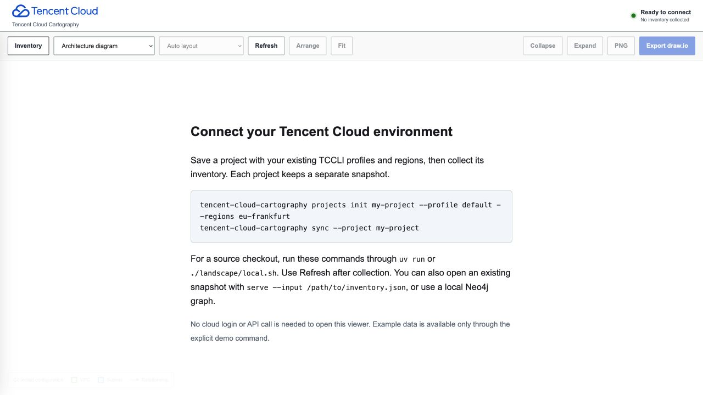

# Tencent Cloud Cartography

Read-only discovery and mapping of your Tencent Cloud environment across accounts, regions and services, with resource inventory, permission analysis and editable architecture diagrams.

Collect resource and configuration metadata using your existing TCCLI profiles. Explore how services connect and review configured access, with collection gaps shown explicitly.

A derivative of [raph-rcn/aws-cartography](https://github.com/raph-rcn/aws-cartography), retaining its Git history and adapting its Landscape interface to Tencent Cloud.

- **Reusable project workspaces:** named projects keep profiles, regions, service selections and snapshots separate; switch projects in the local viewer.
- **Automatic regions per service and account:** new projects default to discovery; `--regions eu-frankfurt` keeps collection restricted to Frankfurt.
- **Read-only collection:** existing TCCLI profiles, an exact metadata API allowlist, pagination, identity checks across credential refresh, and isolated account failures. Authentication may issue temporary sessions and refresh the selected local credential cache.
- **Environment coverage:** account/region/service scope outcomes, organization member/profile reconciliation, explicit exclusions and failed-attempt reporting with previous inventory retained.
- **Architecture and full graph views:** account → region → VPC → availability zone → subnet, based on returned resource IDs. Search, service/account/region filters, inspector, three layouts, collapse/expand.
- **Exports:** PNG and editable draw.io diagrams with embedded Tencent SVGs.
- **All 896 official product icons:** 441 English and 455 Chinese SVGs, searchable gallery, original bytes, checksums, and source attribution.
- **Two local data sources:** private JSON snapshots (`0600`, atomic replacement) or direct Neo4j reads, with refresh support. The viewer makes no Tencent API calls.



**Parity status:** this is still an incomplete replacement for the AWS backend. The [capability audit](docs/PARITY.md) tracks all 66 enabled AWS collector slots and the remaining relationship, analysis, workflow and runtime gaps.

## Quick start

Requires Python 3.11+, [uv](https://docs.astral.sh/uv/), Node.js 22+, and a current [Tencent Cloud CLI](https://github.com/TencentCloud/tencentcloud-cli) for live collection. Development verified against TCCLI 3.1.181.1. Use the source checkout below, or the portable wheel described under Installation. The wheel includes the compiled viewer and all official assets; Node.js is needed only to build from source.

```bash
git clone https://github.com/raph-rcn/tencent-cloud-cartography.git
cd tencent-cloud-cartography
./landscape/local.sh install
./landscape/local.sh serve
```

Open **http://127.0.0.1:8787**. A fresh installation shows an empty setup screen with the official Tencent Cloud wordmark. Opening the viewer requires no cloud login and makes no cloud calls. Diagrams appear after collecting or importing real inventory. Example fixtures are available only through explicit `demo` or `serve --input` commands.

## Installation and multiple projects

The compiled wheel is portable across project folders. Build it once from the
checkout (requires uv and Node.js):

```bash
uv run python scripts/build_distribution.py
uv tool install dist/tencent_cloud_cartography-0.8.0-py3-none-any.whl
```

The installed `tencent-cloud-cartography` command works outside the source checkout.
Each working directory has its own `.local/projects` store by default. Use an
absolute `--projects-dir` when you want one shared catalog across working directories:

```bash
tencent-cloud-cartography projects init client-a --profile client-a --regions auto
tencent-cloud-cartography projects init client-b --profile client-b --regions ap-singapore,ap-hongkong
tencent-cloud-cartography projects list
tencent-cloud-cartography serve
# After separately authenticating the existing profiles:
tencent-cloud-cartography sync --project client-a
tencent-cloud-cartography sync --project client-b
```

Choose the project in the viewer, then Refresh after syncing. Project settings
contain profile names, region codes and optional service selections, never credentials.
Inventories are private files under `.local/projects/NAME/inventory.json`. The same
commands work through `./landscape/local.sh` in a checkout. Repeating `--profile`
can group several distinct accounts in one project; organization members are matched to identity-verified selected profiles; members
without collection access are shown as unscanned. Membership does not authenticate
or automatically scan a member account. Service availability, API permissions and credential
adapter support still determine collected coverage in each environment.

```bash
# Shared catalog; the projects-dir option precedes init/list for project commands.
tencent-cloud-cartography projects --projects-dir /path/to/workspaces init client-c \
  --profile client-c --regions ap-tokyo --services vpc,cvm,cos
tencent-cloud-cartography sync --projects-dir /path/to/workspaces --project client-c
tencent-cloud-cartography serve --projects-dir /path/to/workspaces --project client-c
```

Explicit profile/region/service/output flags override saved project settings for
that sync only. `serve --input FILE` and `serve --neo4j-uri URI` open fixed data
sources; use `serve` for the project selector. Neo4j publication replaces one mirror
generation: use separate databases/instances for separate projects when mirroring.
No setup screen fabricates resources or silently opens synthetic inventory.

## Collect your account

Authenticate locally, using your usual TCCLI profile. Browser/SSO sessions and explicitly configured roles share one renewable, identity-checked session across all collectors. See [authentication and read-only boundaries](docs/AUTHENTICATION.md). Do not put keys in repository files or command history.

```bash
tccli auth login
tccli sts GetCallerIdentity --profile default
./landscape/local.sh sync --profile default --regions eu-frankfurt
./landscape/local.sh serve
```

`sync` writes `.local/inventory.json`. **Exit code 2 means a usable but partial snapshot was saved**. An unavailable account does not discard healthy accounts. If no usable inventory was collected, exit 1 preserves the previous inventory and saves a private failed-attempt report. Exit 1 also covers stopped collection or unconfirmed database publication. A JSON snapshot saved before a database failure remains available. Exit code 0 means all selected operations completed and all discovered resources were enriched; it does **not** promise Tencent-wide service coverage.

Use **Refresh** in the viewer after syncing. File mode rereads the atomically replaced JSON file; Neo4j mode reads the latest published database generation. Neither mode needs a viewer restart. Collection never replaces a live snapshot with demo data.

More options:

```bash
# Multiple regions and accounts (repeat --profile; each must resolve to a different account)
./landscape/local.sh sync --profile production --profile development --regions eu-frankfurt,ap-singapore

# Faster focused enrichment; Cloud Resource Center baseline still runs
./landscape/local.sh sync --services vpc,cvm,cbs,clb,cos --regions eu-frankfurt

# Existing Kubernetes context, matched to a collected TKE endpoint
./landscape/local.sh sync --services tke,cam,tcr --regions eu-frankfurt \
  --kube-context ACCOUNT_UIN/eu-frankfurt/cls-CLUSTER_ID=EXISTING_CONTEXT

# Keep multiple snapshots
./landscape/local.sh sync --output .local/frankfurt.json
./landscape/local.sh serve --input .local/frankfurt.json --port 8788
```

## Environment-wide collection coverage

[The collection guide](docs/COLLECTION-COVERAGE.md) documents automatic per-service
region discovery, explicit restrictions, organization/profile reconciliation,
account failure isolation and the coverage overview. New projects default to `auto`;
existing region settings are preserved. `--discover-regions --regions eu-frankfurt`
discovers service availability while retaining a strict Frankfurt restriction.

## What is collected

The latest extension joins named CAM principals with COS resource policies/ACLs,
evaluates configured role trust and permission chains, and adds permission boundaries and identity-policy decisions,
COS public-access configuration analysis, TKE/Kubernetes summaries and current
context authorization reviews, traditional/modern CLB target and health metadata,
deeper database/compute configuration, and the additional service families below.
See [implemented capabilities and exact metadata parity gaps](docs/METADATA-PARITY.md).
Full AWS parity and live Frankfurt collection are not claimed.

The **Cloud Resource Center** `SearchResources` API supplies a baseline of supported resource types. Native collectors enrich the services below and derive relationships from returned identifiers. Documented CloudRC CBS, CKafka and MySQL type aliases share their native identities; original inventory metadata and provenance remain visible. Missing regions stay unknown until a matching global native resource is collected. CloudRC’s ambiguous SCF type stays unresolved instead of being merged with an SCF namespace. Baseline-only products are available through **Show unresolved inventory** with `inventory-only` status. Referenced resources that could not be enumerated remain `reference` nodes. Unknown products use a clearly generic question-mark icon; every registered kind maps to a bundled official asset, including the explicitly generic LKE/ADP fallback.

| Area | Native services and relationships |
|---|---|
| Network | VPC, subnets, security groups and rules, route tables and typed next hops, ACL rules, NAT, EIP, network interfaces and individual IPv4/IPv6 addresses, scoped CLB target matches, Private Link, peering, CCN attachments; returned VPC/subnet/group/route/NAT/interface references |
| Compute | CVM, Lighthouse, owned/in-use images and snapshot sharing metadata, key pairs, launch-template headers, Auto Scaling group settings and memberships (launch configuration references only; version/configuration APIs containing user data excluded), CBS disks/snapshots and attachments |
| Load balancing | CLB, listeners/rules and returned backend target IDs or endpoint addresses |
| Registry inventory | TCR Enterprise registries, namespaces, repositories, tags and image digests |
| Databases | TencentDB MySQL, PostgreSQL, Redis, MongoDB, SQL Server, MariaDB, CDWPG and typed Elasticsearch configuration |
| Storage | COS buckets, ACL/policy, encryption/KMS, versioning and logging; CFS file systems, mount targets, permission groups and export rules |
| Serverless and integration | SCF namespaces/functions, versions, aliases, triggers and layer versions; API Gateway services/APIs/environments/releases/domains and selected backend links; CKafka instances, topics, partitions and delivery/trigger links; TDMQ for CMQ queues, topics, subscriptions and dead-letter routes; EventBridge buses, rules, targets and resource links |
| Email | SES sending domains, verification state, DKIM key size and DNS checks; exact collected DNSPod record links |
| Identity and keys | CAM users/groups/roles, memberships, policy attachments and conditional statements; KMS metadata and aliases; Secrets Manager metadata and explicit key relationships |
| Secrets Manager | Secret lifecycle, version IDs, rotation configuration, KMS and explicit resource associations; no secret contents |
| Resource tags | Shared tag nodes and `TAGGED` relationships, exact QCS matching and visible unresolved bindings |
| Big data | EMR standard/TKE clusters, host/database/isolated nodes, explicit network and CVM/TKE relationships |
| Configuration audit | CloudConfig recorder and resource-type scope, rules/parameters/triggers, delivery settings and explicit COS/CLS destinations |
| Monitoring | Cloud Monitor policies, metric/event rules, notices and object bindings with explicit CVM links; CLS alarms, query/topic links, schedules, notice channels and escalation configuration; scheduled SQL tasks and declared metric outputs |
| Edge and DNS | CDN certificate-deployment domain metadata and deployed certificate links (partial coverage); owned DNSPod domains and Private DNS zones with records, nameservers, subzones and explicit VPC bindings |
| Containers | TKE network/version/lifecycle, endpoints/ACL/SG/public CA/OIDC/logging metadata; optional existing Kubernetes contexts collect fixed Tables for nodes, pods, services, controllers and jobs, container summaries and current-context pod exec authorization reviews |
| Database depth | Typed MySQL, PostgreSQL, Redis, MongoDB, SQL Server, MariaDB and CDWPG lifecycle/capacity/network/endpoints; supported independent SSL/SG/encryption and Redis replica/node/shard checks |
| Identity and security extensions | CAM boundaries, key identifiers/protection flags and SAML/OIDC; CIC spaces/groups/safe memberships/permission configs/account assignments; organization units/members; CIAM user stores; CWP/TCSS asset/package/vendor vulnerability metadata; CSIP rules/license/aggregate alert counts |
| Infrastructure and data/AI | International CVM reservations, legacy TIC stack/version/event metadata, CloudRC-scoped Tcaplus table groups, WeData projects/workflows/tasks, DLC engines, TI resource-group/notebook summaries and LKE/ADP app/model/shared-knowledge summaries |
| Registry extensions | TCR replication and image-acceleration metadata; Personal Edition owned repository/tag summaries; manifest/config/layer content excluded |

See [the exact API catalog](tencent_cloud_cartography/catalog.py). API versions are pinned. Global services are queried once per account, regional services once per selected region. The global CloudRC pass queries the account inventory. With an explicit region restriction it retains global or unknown-region resources; unrestricted automatic collection also retains returned regional inventory and records native discovery gaps. COS lists bucket metadata account-wide and retains the selected regions.

SES supports `ap-guangzhou` and `ap-hongkong` on the mainland API endpoint, and `ap-singapore` on the international endpoint. Other regions, including Frankfurt, are recorded as unsupported without sending a SES request.

### Coverage and limits

- Cloud Resource Center covers [supported resource types](https://cloud.tencent.com/document/product/1791/115765), can lag, and is not a complete cloud asset census. [Tencent FAQ](https://cloud.tencent.com/document/product/1791/115771).
- Denied, unsupported, failed, excluded, empty and completed queries are distinguishable in **Collection coverage**. Pagination detects stalled pages, count changes, missing arrays, and premature EOF. Request IDs are retained when the API supplies them.
- The graph includes conservative named COS authorization, role trust/permission paths, identity-policy/boundary matches, anonymous COS policy/ACL decisions and configured CLB exposure paths with evidence and completeness flags. It does not establish complete effective cloud authorization, public reachability, routing outcomes or exploitable attack paths. Kubernetes authorization reviews apply only to the selected current context and never execute a command.
- Multi-subnet resources remain at their common returned VPC/region with explicit subnet edges. References may be incomplete when APIs omit IDs or use unsupported formats.
- COS listing and six bucket configuration operations use the official COS SDK over verified HTTPS. Structured bucket listing follows continuation markers. COS, Cloud API, international CVM and TIC collectors share the selected profile, renewable authentication and credential-generation identity checks. Explicit profiles take precedence; environment credentials are used only for an absent default profile, with no source merging or fallback for missing named profiles. [Supported sessions and expiry handling](docs/AUTHENTICATION.md). COS methods do not expose successful request IDs.
- Additional COS notifications, database backup/proxy/replica settings, gateway backend/domain mappings and federation provisioning metadata are implemented. See [implemented contracts and retained exclusions](docs/METADATA-DEPTH.md).
- Native collectors are schema-checked against the installed Tencent SDK and covered by offline tests. **Live account validation requires your own authenticated profile.** API availability and permissions can differ between accounts and regions.
- The frontend defaults to 2,500 selected resources with a visible truncation notice. Containment parents may add a small number of nodes. PNG dimensions are bounded; large graphs are better explored with filters.

## Permissions and data handling

Grant metadata list/describe permissions for the APIs in the catalog, plus `sts:GetCallerIdentity`, CloudRC `SearchResources`, and COS bucket listing if used. Use your organization's existing read-only role; unavailable privileges appear as coverage gaps. A generated [action inventory](docs/api-actions.json) is provided for policy review, **not as a deployable universal CAM policy** (resource scope and condition support vary).

No collector retrieves COS objects, secret values, SCF source, database contents, or decrypts keys. The saved property allowlist excludes credentials, function environment variables and user data. CAM policy and role trust documents are retained as configuration, including conditions, actions, resources and explicit deny statements. Resource names, identifiers, IP addresses, network rules and policy conditions are infrastructure-sensitive. Keep `.local/` private. APIs can return more metadata than is retained, so normal read permissions are still needed.

CAM collection includes group membership, direct user/role/group attachments, policy/trust statements, permission boundaries, credential identifiers/protection flags and selected SAML/OIDC configuration. Analysis intersects collected boundaries and identity policies, retaining explicit denies, conditions, unsupported expressions and scope. Missing boundary data does not establish absence. Joined COS and role-trust decisions evaluate supported nonsecret context offline. See [authorization semantics and remaining uncertainties](docs/AUTHORIZATION.md). These decisions do not establish complete effective authorization or successful role assumption.

KMS collection queries both customer-created and service-created keys, then retains key descriptions, aliases, lifecycle, origin and rotation metadata. CBS disks and Secrets Manager metadata link to explicitly configured KMS key IDs. A disk's encryption flag alone does not identify a key. Exact regional CAM key-resource expressions link policy statements to known keys; `NAMES_RESOURCE` and `CONFIGURED_KMS_KEY` describe configuration, not permission to decrypt. Tencent key aliases are key attributes; AWS key-policy and grant analysis still needs provider-specific authorization work.

DNS collection retains record values, TTL, weight, routing line and enabled state. Public names, private zone views and VPC address scopes remain separate. Subzone links require an enabled NS record matching the child zone's assigned nameserver. IP matches use collected resource addresses and explicit network scope. These links describe configuration; they do not establish DNS resolution or network reachability. Shared public domains, cross-zone private resolver precedence and additional managed-service aliases remain incomplete.

Enterprise TCR separates registry-scoped mutable tags from digest content nodes. Public/anonymous flags do not establish effective access. Repository discovery survives a denied namespace query. Replication and acceleration configuration have their native semantics, without claiming pull-through cache equivalence. Personal Edition collects owned repository/tag summaries separately; its ImageId/TagId is not treated as a digest. Exact Kubernetes Table image references can link to collected Enterprise tags. Manifests/config/layers/attestations remain excluded.

SCF collects version and alias routing, trigger configuration and layer version metadata. Trigger targets distinguish numeric versions from aliases; weighted and rule-based routes retain their conditions. Selected COS, CKafka and API Gateway source links require matching collected resources in the same account and the correct region. Disabled triggers remain configuration nodes. Custom event arguments, credential-bearing trigger fields and unfiltered function configuration are excluded. Function-to-layer usage, execution-role/VPC/image details and effective invocation permissions remain incomplete.

API Gateway retains frontend method/path, selected backend configuration, authentication type, environments, releases and custom domain/certificate references. Environment publication status controls release links; a saved API configuration is not proof that the same backend is deployed. SCF and WebSocket backend roles resolve against collected function identities, including explicit namespaces and qualifiers. Backend VPC associations do not determine API placement. Upstream/TSF configuration, custom domain path mappings, historical deployment contents and effective access analysis remain incomplete.

The HTTP viewer and optional Neo4j bind to loopback. HTTP Host/Origin checks reject foreign browser origins. Do not expose the unauthenticated local services through a tunnel or reverse proxy.

## Neo4j-backed viewer

Docker must already be running. This uses different ports and a separate volume from the original AWS project.

```bash
./landscape/local.sh start
./landscape/local.sh sync --neo4j-uri bolt://127.0.0.1:7688
./landscape/local.sh serve --neo4j-uri bolt://127.0.0.1:7688
# Viewer: http://127.0.0.1:8787
# Neo4j Browser: http://127.0.0.1:7475
./landscape/local.sh stop
```

Each sync atomically replaces only `:TencentCartography` nodes in the mirror. The mirror represents the last supplied snapshot, not an accumulated fleet history. Other graph labels are retained. Nodes are `:TencentResource`; edges use `:TENCENT_RELATIONSHIP {kind: ...}`. The UI supports either backend. A database scan retains account labels, coverage, mode and all graph properties. Readers verify a generation fingerprint and retry if a concurrent publication changes the graph; a missing, inconsistent or unavailable database returns an explicit error instead of an empty-success response. The viewer issues only fixed read queries. Use a database user with read privileges when your Neo4j edition supports that role; driver read mode alone is not an access-control boundary.

Import an existing snapshot without any cloud calls:

```bash
./landscape/local.sh import --input .local/inventory.json --neo4j-uri bolt://127.0.0.1:7688
./landscape/local.sh serve --neo4j-uri bolt://127.0.0.1:7688
```

Both `sync`, `import` and `serve` support `--neo4j-user`, `--neo4j-database`, and `--neo4j-password-env` (default `NEO4J_PASSWORD`). The username/database can also come from `NEO4J_USER` / `NEO4J_DATABASE`. Supply the password through your normal environment/credential tooling, not through command-line arguments. `--input` and `--neo4j-uri` select mutually exclusive viewer sources. Only direct loopback Bolt URIs are accepted; routing URIs and embedded credentials are rejected.

Older mirrors from the initial release lack the required metadata. Re-sync or use `import` to upgrade them. The publication transaction changes only this application's graph and state; unrelated graph data is retained.

## Icons and attribution

All registered kinds map to bundled official assets. The pinned archive lacks an
LKE/ADP product logo; those nodes use the official generic API asset, as recorded
in the parity report. It is not labeled as a product-specific logo.

Open [/icons.html](http://127.0.0.1:8787/icons.html) in the local viewer. Click an asset to download its original SVG. The [manifest](landscape/web/public/icons/tencent/manifest.json) records source archive, filenames, SHA-256 hashes and retrieval date.

```bash
uv run python scripts/update_tencent_icons.py --check
# Re-import the pinned official archive:
uv run python scripts/update_tencent_icons.py
```

Tencent assets come from the [official icon library](https://cloud.tencent.com/act/event/icons). They remain Tencent's intellectual property and are not relicensed under the repository's Apache license. See [NOTICE](NOTICE). This project is independent of Tencent.

## Development

```bash
uv sync --frozen
uv run pytest
uv run pre-commit run --all-files
cd landscape/web
npm ci
npm test
npm run build
npm audit --audit-level=high
```

Real Neo4j integration tests run in CI against a disposable authenticated Neo4j 5.26 instance. They cover exact round trips, isolation from unrelated nodes, transaction rollback, concurrent publication, read-only query boundaries, corruption detection and HTTP refresh. To run locally, set `TEST_TENCENT_NEO4J_URI` and optional `TEST_TENCENT_NEO4J_USER`, `TEST_TENCENT_NEO4J_PASSWORD`, `TEST_TENCENT_NEO4J_DATABASE`, then run `uv run pytest tests/integration -v`. Tests refuse a nonempty database and are skipped when the opt-in URI is absent.

Other tests cover pagination negative controls, blocked operations, identity changes, scoped collection, graph reconciliation, property redaction, icon mappings, hierarchy, draw.io embedding, local HTTP boundaries, and frontend filtering/exports. CI runs these checks. Browser smoke validation is documented in [VALIDATION.md](docs/VALIDATION.md).

## Source history

Started from committed AWS fork revision `48780ef5`; uncommitted changes in the original local checkout were not copied or modified. The AWS-specific backend and asset pack were replaced. The original Cytoscape Landscape interaction model and Apache attribution are retained. `upstream-aws` points to the source repository.

### Certificates, CLB rules and compute roles

SSL certificate inventory retains domains/SANs, issuer source, type, status, algorithms and lifecycle metadata. Tencent certificate timestamps retain their documented Asia/Shanghai timezone. Private-key detail/download endpoints remain outside the allowlist. CLB listeners and routing rules are distinct nodes; server certificates, additional server certificates and client CA certificates use separate configured relationships. A configured client CA does not imply client verification is enabled. API Gateway certificate references reconcile with the same global account-scoped inventory.

CVM CAM role names resolve only against unique collected roles in the same account. Unknown or ambiguous role names remain visible reference nodes. These are configured role bindings, not proof of effective permissions or successful role assumption.

### Audit and log delivery

CloudAudit tracks include selectors, enabled state, organization-delivery flags and configured storage destinations. CLS includes log sets, log and metric topics, retention/index/web-tracking settings, custom KMS references and COS shippers. Destination links use explicit IDs or unique collected bucket identities, including the destination's actual region. `delivery_verified=false` distinguishes configuration from successful log delivery. Unknown/ambiguous destinations stay visible in resource properties. No audit-event or log-content API is allowed.

### Analyze collected configuration offline

```bash
uv run tencent-cloud-cartography analyze \
  --input .local/inventory.json \
  --output .local/analyzed.json
uv run tencent-cloud-cartography serve --input .local/analyzed.json
```

Collection also runs this analysis automatically. In full graph view, permission
analysis nodes connect a principal, target and matching statements. The initial
map covers COS object read/write, secret-value access and CAM role passing.
Results distinguish explicit deny, conditional, incomplete and allow/implicit
deny from collected identity policies. COS object prefixes remain scoped;
missing policy reads suppress allow conclusions. This command makes no cloud
calls. Resource policies, session constraints and role trust still need further
analysis before effective access can be determined.

Offline analysis also builds configured CLB exposure paths and direct EXPOSE links
to corroborated CVM/interface-address targets. Full graph view preserves the
listener/rule and backend evidence. Unresolved backends remain partial; these
relationships do not establish public reachability or successful connections.

### Networking metadata coverage

Version 0.6.0 adds native CLB/SCF and corroborated cross-VPC/region targets,
shared CCN discovery, Private Link access lists and DNS/ENI reconciliation,
GWLB, gateway identities and public IPv6 variants. Read the
[14-row networking parity matrix](docs/NETWORK-PARITY.md) for the exact
implementation and provider differences. Collection remains read-only and
metadata-only; configured exposure does not prove runtime reachability.

### Storage, database and secret metadata coverage

Version 0.7.0 adds 37 metadata reads: database proxy/cluster/backup/parameter
configuration, DLC/CDWPG accounts and grants, Elasticsearch request/backup
controls, CFS snapshots/lifecycle and secret rotation history. Optional
`sync --cos-object-acls FILE` reads ACL metadata for explicitly named objects;
`analyze --session-policies FILE` evaluates declared session restrictions offline.
Read the [nine-area parity and usage guide](docs/STORAGE-DATABASE-PARITY.md) for
scope, examples and retained provider/security limits. No object contents,
database credentials, queries or secret values are retrieved.


### Platform, security and authorization metadata

Version 0.8.0 adds 46 safe reads for DNS forwarding/shared domains, certificate
consumers, security scan settings/coverage, CloudConfig aggregators, CIC SAML and
provisioning metadata, legacy CloudAudit, metric dimensions, TI resource jobs,
LKE quota and WeData catalogs/schemas. Kubernetes RBAC policy metadata and richer
offline conditions/session restrictions extend authorization analysis. Read the
[15-area implementation and disposition](docs/PLATFORM-PARITY.md) for exact scope,
usage and the password/payload-bearing APIs that remain blocked. Full AWS parity
and effective runtime access remain unverified.
